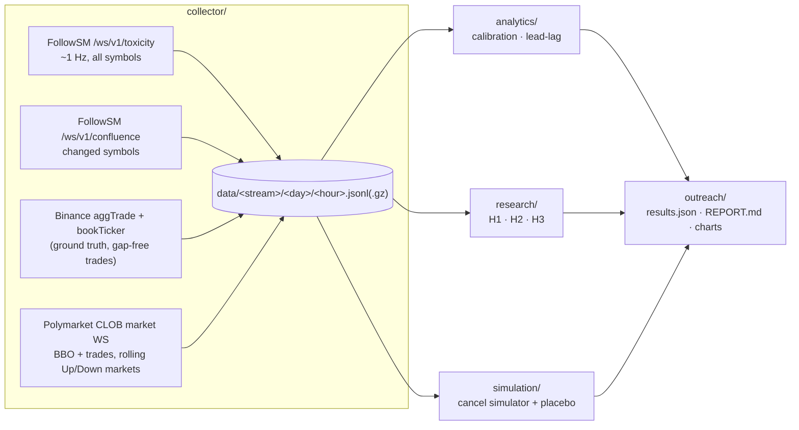

# tick-microstructure-research

**Do FollowSM's live tick signals actually protect a market maker, and by how much?** The repo started with that question for crypto markets, and it is still open: the live capture needs 14 clean days. Along the way it grew a historical track on Binance's 24/7 equity perps and the Polymarket markets that price the same stocks, which is finished (see below).

The crypto track:

- **Capture.** It records FollowSM's Enterprise streams (`/ws/v1/toxicity`, `/ws/v1/confluence`) alongside the venues' own public tick data, which serves as ground truth.
- **Calibrate.** It profiles the order-book signals.
- **Test.** It tests three hypotheses, each against a control group.
- **Simulate.** It simulates quote cancellation on real Polymarket books and compares every result with a **placebo** that fires the same trigger at random times.

Written as a follow-up to the [dynamic-inventory-hedger backtest](https://github.com/Follow-SM/dynamic-inventory-hedger#honest-backtest--methodology). That backtest could only rebuild VPIN from 1-minute public bars, and it found no timing value. The question left open was whether **tick-level book and sweep signals** do better. This repo collects the data needed to answer it.

## Where the research stands (30 September 2026)

| Track | Data | Status | Result |
|---|---|---|---|
| **Crypto, live tick capture** (H1–H3, cancel simulator) | FollowSM Enterprise streams + Binance + Polymarket, recorded by `tmr collect` | **Collecting.** The backend moved to a local order book on 30 Sep 2026, which changed what the ±X% depth metrics (incl. `ob_toxicity_1pct`) mean. The 14 clean days count from that switch; `tmr analyze` uses only post-switch data by default | None yet. The report says **INSUFFICIENT** and recommends no threshold until 14 days exist |
| **Tokenized equities vs US sessions** (Part 3) | 1,663 US opens, 12 Binance equity perps, Jan–Sep 2026 | Done: `research/TRADFI_REPORT.md` | The perp prices the opening gap before the bell (slope 1.00, R² 0.998; median unpriced part 4.3 bps). Off-hours flow and VPIN don't predict the rest. Crypto-style volume alarms fire on ~50% of the first 15 minutes after the open; session-slot baselines fix it |
| **Polymarket equity Up/Down vs the perps** (Part 4) | 1,537 market-nights: every taker fill + 1-minute CLOB history | Done: `research/POLYMARKET_REPORT.md` | No multi-minute lead: both venues move in the same minute. The perp-implied probability is better calibrated in every session (perp side right 62.5% of RTH disagreements > 5¢). Off-hours Polymarket flow and whale sweeps don't predict the gap the perp misses |

What the backtests in [dynamic-inventory-hedger](https://github.com/Follow-SM/dynamic-inventory-hedger/tree/main/research) built on these results:

- **Hedging a Polymarket equity position with the perp** (`backtest_tradfi.py`): session-aware σ is the lever that matters (P&L spread −57%, 5% ES −$596 → −$526 per 1,000 shares, $27 cost). Wall-clock σ made the tail worse than not hedging; microstructure gating and an open-window freeze did not help.
- **Market-making Polymarket off the perp's fair value** (`backtest_confluence.py`, 1,313 market-nights): +$6.2k (Sharpe 1.7) against −$46.5k for quoting Polymarket's own mid; 0 of 20 placebo seeds matched it. The edge was small (~$42 a trading day across 11 books), needed quote updates within seconds, and almost all of it came before mid-June. **Out of sample** (the same code on 29 Sep – 13 Oct 2026, 120 market-nights) it lost $2,956, and 18 of 20 placebo seeds did at least as well. Perp delta hedging and the one-hour early exit cost more than they saved for a small two-sided book.

One lesson for anyone joining Polymarket history to other data: CLOB `prices-history` points are stamped 3–15 s *after* each minute. Taking the last point before a minute ends builds a fake one-minute lag into every row (`polymarket_study.sample_at`, pinned by a test). The live collector is not affected: it timestamps on receive and reads the Polymarket WebSocket.

### What the finished work changes for the crypto track

- **The simulator now runs two quoters.** Quoting around the Polymarket mid was the losing baseline in the equity backtest (−$46.5k against +$6.2k for quoting around the perp's fair value), so a breaker scored only on top of it could look useful because the quoter is bad. The mid-centred maker stays as the naive control; a second quoter centres on a Binance-implied fair value (`simulation/fair_value.py`), and every breaker is scored on both.
- **The latency sweep now reaches 60 s.** The equity edge was the same at 250 ms and 1 s, 22% lower at 5 s and a loss at 60 s, so the cancel-latency sweep runs 0 ms → 60 s.
- **Expect the triggers to struggle.** VPIN showed no timing value in the 1-minute hedger backtest or against the opening gap, the toxicity breaker was nearly neutral in the equity market-making backtest, and whale sweeps didn't beat placebos. The H3 public-data baseline and the placebo comparisons are the bar to clear.

> Every number in a report is generated from data. The live-capture report states **INSUFFICIENT** until at least 14 days of clean capture exist, and it never recommends a threshold before then.

---

## Architecture



| Package | Plan task | What it does |
|---|---|---|
| `collector/` | 1 | Async WebSocket consumers with reconnect and backoff; hourly JSONL, gzipped once the hour closes; optional Parquet export; gap detection |
| `analytics/` | 2 | Rolling 24 h p50/p90/p95/p99 profiles; taker-flow spikes vs a 5-minute EWMA; cross-venue prediction divergence; Binance → Polymarket lead-lag on two clocks |
| `research/` | 3 | H1 depth depletion, H2 whale-sweep cascade, H3 composite vs individual triggers, each against a control |
| `simulation/` | 4 | Paper quote-cancellation simulator: latency budget, adverse selection avoided vs spread missed, placebo benchmark |
| `outreach/` | 5 | P&L/drawdown, lead-lag CDF and depth-distribution charts; a markdown technical report generated from results |

### Why the venues' own data is recorded too

FollowSM streams **1-second snapshots** of order-book and flow metrics. Two of the tests need things those snapshots don't contain:

- **Per-tick taker trades** for H2's single-sweep test. These come from Binance `aggTrade`.
- **Sub-second price paths** for the 10-second outcomes and the latency budget. These come from Binance `bookTicker` and Polymarket's best bid/ask.

So FollowSM provides the **signals**, and the venues provide the **outcomes**. That also keeps the test independent: FollowSM data is never scored against FollowSM data.

### Data integrity

- **Binance trades are gap-free by construction.** Aggregate-trade IDs are consecutive. Any hole (dropped frames or a reconnect) is detected and back-filled from REST `aggTrades?fromId=`, and back-filled rows are tagged `bf: 1`. Holes that can't be recovered are logged as `unrecovered`.
- **Streams without sequence numbers** (FollowSM, Binance `bookTicker`, Polymarket) have reconnect windows and cadence breaks logged as `gap` events. The analytics **exclude any window that touches a gap**, so an outage can't create or hide an effect.
- **Two timestamps on every record:**
  - `rt` is the local receive time, which is when a client here could act;
  - the venue or server timestamp is kept alongside it.
  Signals are evaluated at `rt`. Cross-venue lead-lag is reported on both clocks.
- **Storage.** Files are written with append-only JSONL and rotated hourly. Compression runs on a background thread and swaps files atomically, and readers ignore a torn final line. A crash loses at most the last second.

## The tests

**H1: depth depletion.**
- *Question:* does `ob_toxicity_1pct > 2` predict a Binance mid move of ≤ −10 bps within 10 s, 30 s and 60 s? `ob_toxicity_1pct` is the ask/bid notional ratio within ±1% of mid, so values above 2 mean ask depth is at least twice bid depth.
- *Reported:* down-move and up-move rates with Wilson 95% intervals, against random frames where the condition was false. Up-moves are shown too, so a volatility effect can't pass as a directional one.
- *Thresholds:* walk-forward. A threshold is chosen on the first half and reported on the second.

**H2: whale-sweep cascade.**
- *Question:* does a ≥ $100k taker sweep (one matching event on Binance), confirmed by a same-direction book spike within 5 s, make the matching Polymarket Up/Down market reprice sooner or more often?
- *Controls:* unconfirmed sweeps, and random times with a random direction.

**H3: composite vs individual triggers.**
- *Triggers compared:* `vpin_percentile ≥ 0.95`, sweep, `ob_toxicity_1pct > 2`, and their union. Also a **public-data-only reactive baseline** (a ≥ 10 bps Binance move in 2 s), which a paid signal must beat.
- *What each trigger detects:* Binance move onsets.
- *Scored on:* time active (the cost), coverage at a 0 / 1 / 5 s lead, and precision.
- *Placebo:* the same intervals, circularly shifted.

**Simulation.**
- *Setup:* two makers on every tracked Polymarket Up/Down token, filled by the same recorded trades (at or through the quote), each fill marked out 5, 30 and 60 s later and at settlement:
  - **join best** (naive control): joins the best bid and best ask, i.e. quotes around Polymarket's own mid;
  - **fair value**: quotes a Binance-implied P(Up) ± 2¢, computed 250 ms before each print and never crossing the recorded book. P(Up) = Φ((ln(S/K) − σ²/2)/σ), with S the last Binance trade, K the Binance price at the window start, and σ from the trailing 30 minutes of 1-second returns scaled to the time left. No fair value (no quote) without a trade in the last 10 s.
- *Breaker:* quotes are pulled while a trigger is active. The whole window is shifted by the **latency budget**, stream arrival → evaluator decision → OMS cancel:
  - arrival lag is measured;
  - evaluator latency is measured in-process;
  - OMS latency is a parameter swept from 0 ms to 60 s, because no live orders are placed.
- *Result:* slippage avoided, spread capture missed, and net value, against the placebo distribution.
- *Limits:* the model is deliberately simple and says so. Queue position is ignored (fills are an upper bound). The settlement markout uses Binance's price at the window end, a proxy where a market settles on Chainlink. A breaker that only helps the join-best quoter is switching off a bad quoter, not detecting toxicity; the report shows both.

## Quickstart

```bash
git clone https://github.com/Follow-SM/tick-microstructure-research.git
cd tick-microstructure-research
python3.12 -m venv .venv && source .venv/bin/activate
pip install -e ".[dev,parquet]"
cp .env.example .env          # set FOLLOWSM_API_KEY (ENTERPRISE)

tmr collect                   # runs until stopped; add --minutes N for a test run
tmr analyze                   # results/results.json, outreach/REPORT.md, outreach/assets/*.png
                              # --book-model auto|new|old|all: depth metrics changed meaning on 30 Sep 2026;
                              # auto/new = only data after that switch
tmr export --out parquet/     # optional Parquet copy of every stream
```

- **No Enterprise key?** `tmr collect --venues-only` records the Binance and Polymarket data on its own. Lead-lag and the sweep/move triggers work; H1 and the FollowSM triggers need the Enterprise streams.
- **Status lines.** Every 30 s the collector logs message rates, tracked markets and gap counters.
- **Storage.** Measured at about **210 MB per day, gzipped, for two symbols**, around 9× compression.

### Long captures

The tests need weeks of data, so run the collector as a service. For example, a systemd user unit:

```ini
# ~/.config/systemd/user/tmr-collect.service
[Unit]
Description=tick-microstructure-research collector
After=network-online.target

[Service]
WorkingDirectory=%h/tick-microstructure-research
ExecStart=%h/tick-microstructure-research/.venv/bin/tmr collect
Restart=always
RestartSec=10

[Install]
WantedBy=default.target
```

```bash
systemctl --user enable --now tmr-collect
loginctl enable-linger "$USER"     # keep it running after logout
```

If `systemctl --user` fails with *"Failed to connect to bus"*, there is no user session bus (common over SSH). Use a system unit instead. It runs as your user but needs `sudo` to install:

```ini
# /etc/systemd/system/tmr-collect.service
[Unit]
Description=tick-microstructure-research collector
After=network-online.target
Wants=network-online.target

[Service]
User=ubuntu
WorkingDirectory=/home/ubuntu/tick-microstructure-research
ExecStart=/home/ubuntu/tick-microstructure-research/.venv/bin/tmr collect
Restart=always
RestartSec=10

[Install]
WantedBy=multi-user.target
```

```bash
sudo systemctl daemon-reload && sudo systemctl enable --now tmr-collect
systemctl status tmr-collect                  # state
journalctl -u tmr-collect -f                  # live log; a status line every 30 s
```

Restarts are safe. The collector appends to the current hour, compresses any hours left open by a crash, and the gap between runs is logged and excluded.

### Configuration (`.env`)

| Variable | Default | |
|---|---|---|
| `FOLLOWSM_API_KEY` | | ENTERPRISE key for the WebSocket streams |
| `TMR_SYMBOLS` | `BTCUSDT,ETHUSDT,SOLUSDT,XRPUSDT` | Binance symbols; the ones with Polymarket Up/Down markets get cross-venue tests |
| `TMR_DATA_DIR` / `TMR_RESULTS_DIR` / `TMR_OUTREACH_DIR` | `data` / `results` / `outreach` | Output locations |

## TradFi extension: tokenized equities vs US sessions

The same questions, asked of **equity perps that trade 24/7 while their underlying doesn't**. Binance lists TSLA, NVDA, AAPL, SPY, QQQ and others as `TRADIFI_PERPETUAL` USDⓈ-M contracts, and publishes their full tick tape and 30-second ±0.2/1/2/3/4/5% depth history. So, unlike the crypto backtest, the book signals can be tested historically.

```bash
pip install -e ".[dev,parquet]"
tmr tradfi fetch      # data.binance.vision archives (SHA-256 checked) + Yahoo bars -> data/tradfi/*.parquet
tmr tradfi analyze    # research/results_tradfi.json, research/TRADFI_REPORT.md, research/assets/tradfi_*.png
tmr tradfi pm-fetch   # Polymarket Up/Down + earnings markets, taker fills, 1m history -> data/tradfi/polymarket/
tmr tradfi pm-analyze # research/results_polymarket.json, research/POLYMARKET_REPORT.md, research/assets/polymarket_*.png
```

| Module | What it does |
|---|---|
| `research/utils/session.py` | NYSE calendar on `America/New_York`: RTH, pre, post, overnight, and closed (weekends and holidays), with DST handled and early closes included. Checked against the days Yahoo printed a bar. |
| `research/data/` | Checksummed ingestion into daily Parquet partitions (`aggTrades`, `bookDepth`), plus 1m perp and index klines, funding, and Yahoo daily and 1m bars. Yahoo keeps 1m data for only 30 days, so each run merges into the stored file. |
| `research/tradfi.py` | Vectorized minute features, cached as Parquet: VPIN with a **global** bucket (ADV/50) and a **session-aware** bucket; trailing percentiles; NATR; naive and session-slot volume z-scores; ±1% depth; and the per-symbol book-imbalance percentile. |
| `research/tradfi_study.py` | Session structure, VPIN inflation by session, false "sweeps" at the open, pre-open depth thinning, the tape spread, opening-gap price discovery, off-hours signal tests (permutation p-values, Wilson intervals), and lead-lag against the index and Yahoo pre-market. |
| `research/data/polymarket.py` | Public Polymarket history for the same tickers: daily Up/Down and earnings EPS-beat markets (gamma API), every taker fill with wallet and transaction hash (data API), and the Up token's 1-minute CLOB price history. |
| `research/polymarket_study.py` | Polymarket laid onto the perp's minute grid from the previous close to the resolving close: lead-lag, event curves with random-timing placebos (whale sweeps, probability jumps, perp jumps), calibration of perp-implied vs Polymarket probability by session, off-hours signals vs the unpriced gap (Bonferroni-corrected), and earnings case studies. Point-in-time throughout. |

The hedging side of the question lives in [dynamic-inventory-hedger `research/backtest_tradfi.py`](https://github.com/Follow-SM/dynamic-inventory-hedger/tree/main/research), and the market-making side in `research/backtest_confluence.py`. Both import this package's loaders, session calendar and features.

## Development

```bash
pytest -q && ruff check src tests && mypy
```

- **Offline tests:**
  - storage rotation, compression and crash recovery;
  - trade-hole detection;
  - stream parsing;
  - sweep and move detection;
  - interval logic.
- **Synthetic simulator:** an informative trigger has to beat its placebo, a late one must not, and a slow cancel must miss.
- **End-to-end:** a full pipeline run on a synthetic capture written through the real storage layer.
- **Static checks:** mypy runs in strict mode.

## Plans

| | Free | DEVELOPER ($199/mo) | **ENTERPRISE** ($499/mo) |
|---|---|---|---|
| REST requests/min | 30 (per IP) | 300 | 1,000 |
| `/ws/v1/toxicity` + `/ws/v1/confluence` (needed by `tmr collect`) | ❌ | ❌ | ✅ |

### 👉 [Get your API key at follow-sm.com/pricing](https://follow-sm.com/pricing)

## Disclaimer

Research software, MIT-licensed, provided as-is. Not financial advice. Simulated fills ignore queue position and market impact; paper results overstate what live quoting achieves.
