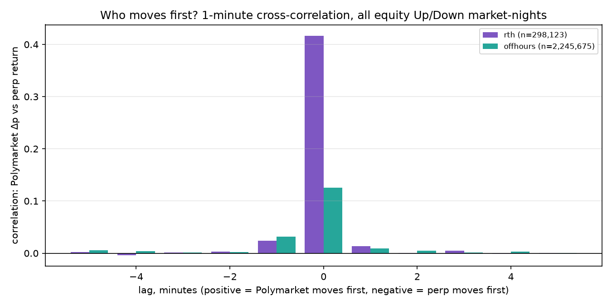
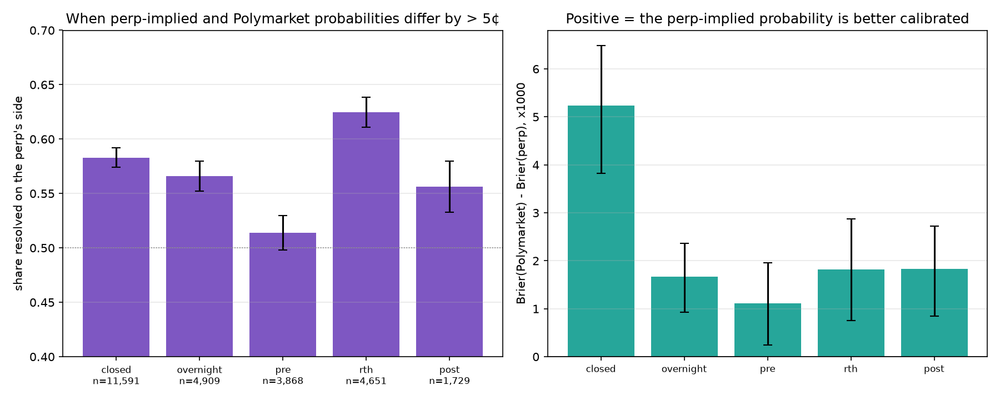
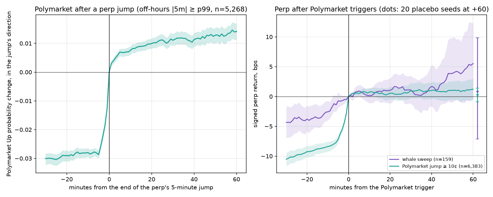

# Polymarket equity Up/Down markets vs Binance TradFi perps

*Generated 2026-09-30 07:39 UTC from `research/results_polymarket.json`: 1537 market-nights.*

## 1. Market size

| symbol | nights | median taker USD / night | off-hours share of PM volume |
| --- | --- | --- | --- |
| TSLAUSDT | 166 | $2,999.78 | 21.1% |
| NVDAUSDT | 125 | $2,459.52 | 26.3% |
| AAPLUSDT | 120 | $2,195.15 | 19.7% |
| SPYUSDT | 116 | $28,728.47 | 47.1% |
| QQQUSDT | 15 | $5,165.39 | 58.1% |
| AMZNUSDT | 157 | $2,378.11 | 20.9% |
| METAUSDT | 125 | $2,194.64 | 21.5% |
| GOOGLUSDT | 126 | $1,995.63 | 25.3% |
| MSFTUSDT | 110 | $1,883.12 | 22.9% |
| COINUSDT | 158 | $1,048.97 | 26.7% |
| PLTRUSDT | 157 | $1,968.97 | 20.1% |
| HOODUSDT | 162 | $1,338.87 | 20.9% |

## 2. Lead-lag (pooled; positive lag = Polymarket moves first)

| resolution | session | minutes | peak lag | corr -1 | corr 0 | corr +1 |
| --- | --- | --- | --- | --- | --- | --- |
| 1m | offhours | 2,245,675 | 0 | n/a | n/a | n/a |
| 1m | rth | 298,123 | 0 | n/a | n/a | n/a |
| 5m | offhours | 450,038 | 0 | n/a | n/a | n/a |
| 5m | rth | 60,246 | 0 | n/a | n/a | n/a |

## 3. Calibration by session (perp-implied vs Polymarket probability)

| session | n | Brier perp | Brier PM | PM - perp 95% CI | perp side right when |Δ| > 5¢ |
| --- | --- | --- | --- | --- | --- |
| post | 10,120 | 0.2467 | 0.2485 | [+0.0009, +0.0027] | 55.6% [53.3%-58.0%] (n=1729) |
| overnight | 21,654 | 0.2301 | 0.2318 | [+0.0009, +0.0024] | 56.6% [55.2%-58.0%] (n=4909) |
| pre | 14,959 | 0.2134 | 0.2145 | [+0.0002, +0.0020] | 51.4% [49.8%-53.0%] (n=3868) |
| rth | 12,348 | 0.1397 | 0.1415 | [+0.0008, +0.0029] | 62.5% [61.1%-63.9%] (n=4651) |
| closed | 25,408 | 0.2496 | 0.2548 | [+0.0038, +0.0065] | 58.3% [57.4%-59.2%] (n=11591) |

### At fixed anchors (ET)

| anchor | n | Brier perp | Brier PM | PM - perp 95% CI |
| --- | --- | --- | --- | --- |
| 04:00 | 1362 | 0.2216 | 0.2239 | [-0.0008, +0.0051] |
| 08:30 | 1329 | 0.2051 | 0.2073 | [-0.0009, +0.0054] |
| 09:28 | 1364 | 0.1957 | 0.2024 | [+0.0026, +0.0110] |
| 10:00 | 1360 | 0.1472 | 0.1489 | [-0.0012, +0.0044] |
| 13:30 | 1388 | 0.0729 | 0.0738 | [-0.0014, +0.0033] |

## 4. Event curves

Triggers: {'sweep': 159, 'pm_jump': 6383, 'perp_jump': 6201}

| curve | n | unit | 30 min before | +5 | +60 | +60 95% CI | placebo seeds ≥ actual |
| --- | --- | --- | --- | --- | --- | --- | --- |
| sweep->perp | 159 | bps | 4.3592 | 0.9203 | 5.5318 | [-0.4103, 12.2740] | 15% |
| sweep->pm | 117 | prob | 0.0185 | 0.0018 | 0.0033 | [-0.0078, 0.0140] | n/a |
| pm_jump->perp | 6383 | bps | 10.5202 | 0.5081 | 1.2302 | [-0.5538, 2.9673] | 10% |
| pm_jump->pm | 6261 | prob | 0.1235 | -0.0679 | -0.0799 | [-0.0830, -0.0766] | n/a |
| perp_jump->perp | 6201 | bps | 40.7474 | 0.3344 | -0.7514 | [-2.8673, 1.2590] | n/a |
| perp_jump->pm | 5268 | prob | 0.0301 | 0.0069 | 0.0142 | [0.0113, 0.0170] | n/a |

## 5. Does off-hours Polymarket predict the unpriced gap or the rest of the day?

14 tests; Bonferroni threshold p < 0.0036.

| signal | target | direction hit rate | rank correlation |
| --- | --- | --- | --- |
| pm_divergence_0928 | residual_gap | 55.1% [51.7%-58.3%] (n=1332) | ρ +0.090, p=0.001 (n=1332) |
| pm_divergence_0928 | rest_of_day | 50.4% [47.7%-53.1%] (n=1332) | ρ +0.016, p=0.539 (n=1332) |
| pm_prob_change_offhours | residual_gap | 43.8% [40.6%-47.1%] (n=1372) | ρ -0.139, p=0.000 (n=1372) |
| pm_prob_change_offhours | rest_of_day | 51.3% [48.6%-54.0%] (n=1372) | ρ +0.048, p=0.074 (n=1372) |
| pm_flow_imbalance_offhours | residual_gap | 44.8% [41.7%-47.9%] (n=1480) | ρ -0.097, p=0.001 (n=1480) |
| pm_flow_imbalance_offhours | rest_of_day | 52.7% [50.1%-55.2%] (n=1480) | ρ +0.032, p=0.221 (n=1480) |
| pm_sweep_net_offhours | residual_gap | 46.9% [33.7%-60.6%] (n=1477) | ρ -0.063, p=0.014 (n=1477) |
| pm_sweep_net_offhours | rest_of_day | 48.9% [38.7%-59.1%] (n=1477) | ρ -0.022, p=0.390 (n=1477) |

| magnitude signal | target | rank correlation |
| --- | --- | --- |
| pm_flow_z_max_offhours | residual_gap | ρ -0.104, p=0.001 (n=923) |
| pm_flow_z_max_offhours | rest_of_day | ρ -0.055, p=0.101 (n=923) |
| stock_vpin_pctl_0928 | residual_gap | ρ -0.009, p=0.750 (n=1445) |
| stock_vpin_pctl_0928 | rest_of_day | ρ +0.006, p=0.827 (n=1445) |
| abs_pm_divergence_0928 | residual_gap | ρ +0.066, p=0.014 (n=1332) |
| abs_pm_divergence_0928 | rest_of_day | ρ +0.053, p=0.053 (n=1332) |

## 6. Earnings EPS-beat markets (case studies)

21 releases. Beat rate 76.2% [54.9%-89.4%] (n=21); Polymarket on the right side 1 h before the move 85.7% [65.4%-95.0%] (n=21); perp reaction agreed with the beat 61.9% [40.9%-79.2%] (n=21). Median minutes for Polymarket to reach 90% on the outcome: 0.0; for the perp to reach half its 60-minute reaction: 3.

## Charts

## Assumptions

- Polymarket: public data-api taker fills (each order arrives as one print, with wallet and tx hash) and CLOB 1-minute price history of the Up token. History points are stamped ~3-15 s past the minute, so a minute's probability is the first point within 30 s after the perp bar closes (a few seconds of look-ahead in Polymarket's favour); NaN if there is none.
- Whale sweep: one taker order >= max($1,000, the 99% quantile of order notional over the symbol's previous 20 nights). Direction +1 = buys Up or sells Down.
- Polymarket flow z: log(1 + 15-minute taker notional) vs the same session and quarter-hour over the previous 20 nights (median / 1.4826 MAD); NaN until 5 nights exist.
- Perp-implied probability: Φ(ln(S/K) / σ), S = perp / (1 + perp-vs-official basis at the previous close), K = the previous official close, σ = std of ln(close / S) at the same anchor over the previous 20 nights of that symbol.
- Residual gap = official open / previous close vs the perp's move to 09:29:00 ET; rest of day = ln(official close / S at 09:29:00), which is what an Up/Down market resolves on. Pre-open signals use Polymarket samples stamped no later than 09:28:30 and flow up to 09:28:00 (no look-ahead).
- Event curves: 30-minute cooldown per trigger type and night; placebos keep each trigger's direction and night and draw a uniform minute in the same off-hours window.
- All p-values are permutation tests; the report lists a Bonferroni threshold for each family.
