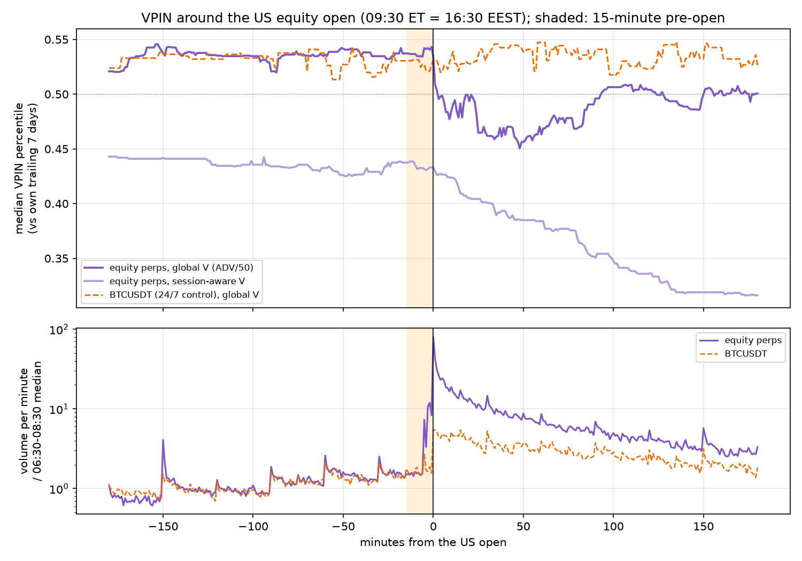
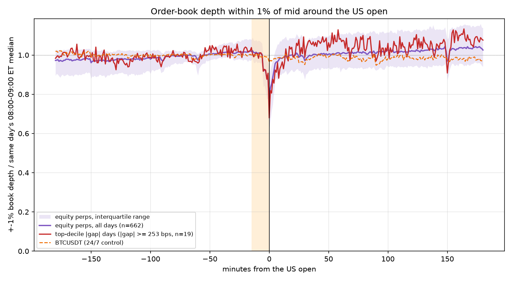
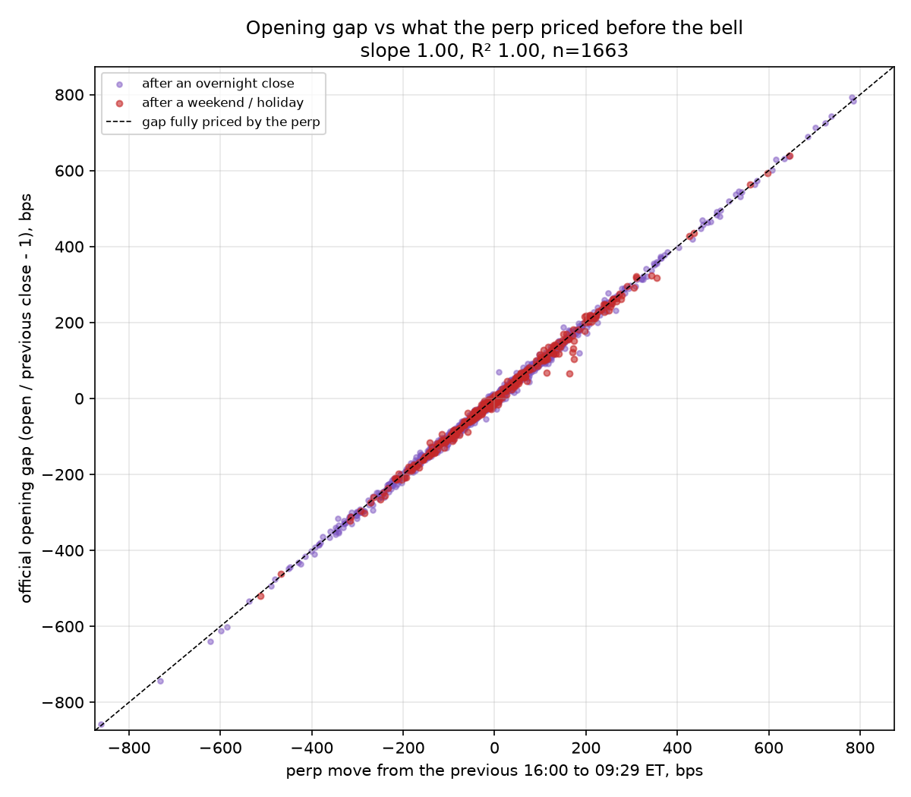
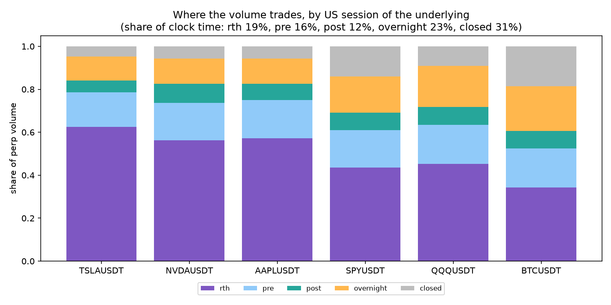
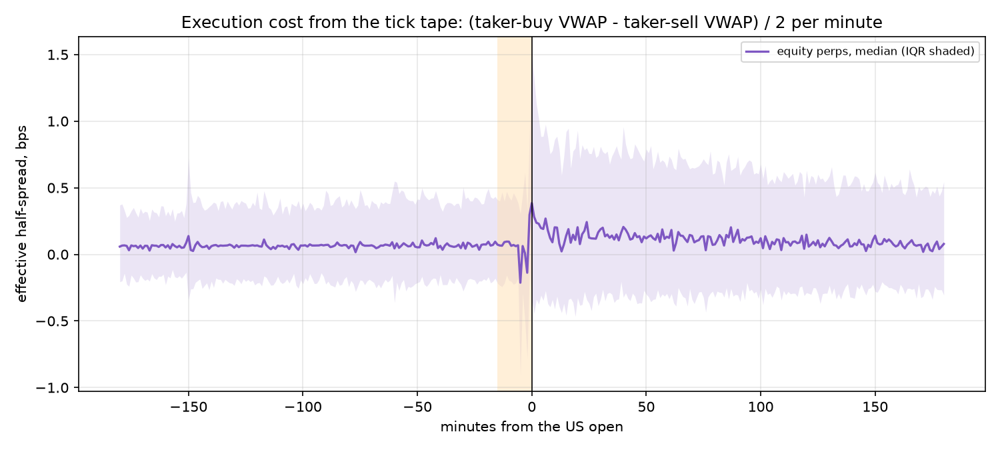

# Tokenized equities vs 24/7 crypto: session microstructure and gap risk

*Generated 2026-09-30 05:38 UTC from `research/results_tradfi.json`.*

## 1. Where the volume trades

| symbol | period | rth volume | pre volume | post volume | overnight volume | closed volume |
| --- | --- | --- | --- | --- | --- | --- |
| TSLAUSDT | 2026-01-28 to 2026-09-28 | 62.5% | 16.0% | 5.5% | 11.3% | 4.7% |
| NVDAUSDT | 2026-03-26 to 2026-09-28 | 56.2% | 17.5% | 8.9% | 11.8% | 5.6% |
| AAPLUSDT | 2026-04-06 to 2026-09-28 | 57.2% | 17.8% | 7.6% | 11.8% | 5.6% |
| SPYUSDT | 2026-04-06 to 2026-09-28 | 43.5% | 17.5% | 8.1% | 17.0% | 14.0% |
| QQQUSDT | 2026-04-06 to 2026-09-28 | 45.4% | 18.1% | 8.2% | 19.1% | 9.2% |
| AMZNUSDT | 2026-02-09 to 2026-09-28 | 51.5% | 21.4% | 10.0% | 11.4% | 5.7% |
| METAUSDT | 2026-03-26 to 2026-09-28 | 59.6% | 21.8% | 6.7% | 8.5% | 3.4% |
| GOOGLUSDT | 2026-03-26 to 2026-09-28 | 53.6% | 19.8% | 9.7% | 11.7% | 5.3% |
| MSFTUSDT | 2026-04-20 to 2026-09-28 | 52.6% | 21.5% | 9.0% | 11.5% | 5.4% |
| COINUSDT | 2026-02-09 to 2026-09-28 | 57.9% | 16.9% | 6.7% | 11.6% | 6.9% |
| PLTRUSDT | 2026-02-09 to 2026-09-28 | 61.2% | 17.0% | 6.8% | 10.1% | 4.9% |
| HOODUSDT | 2026-02-02 to 2026-09-28 | 56.9% | 19.0% | 6.4% | 12.0% | 5.7% |
| BTCUSDT | 2025-12-31 to 2026-09-28 | 34.4% | 18.0% | 8.2% | 20.9% | 18.5% |

## 2. VPIN by session: global V (ADV/50) vs session-aware V

| symbol | mode | rth: median / time ≥ p95 | pre: median / time ≥ p95 | post: median / time ≥ p95 | overnight: median / time ≥ p95 | closed: median / time ≥ p95 |
| --- | --- | --- | --- | --- | --- | --- |
| TSLAUSDT | global_v | 0.124 / 13.2% | 0.129 / 13.6% | 0.126 / 14.6% | 0.126 / 12.3% | 0.123 / 11.2% |
| TSLAUSDT | session_v | 0.142 / 1.8% | 0.154 / 4.8% | 0.136 / 1.3% | 0.155 / 5.5% | 0.217 / 20.7% |
| NVDAUSDT | global_v | 0.137 / 9.4% | 0.144 / 9.3% | 0.139 / 13.1% | 0.140 / 7.5% | 0.136 / 9.0% |
| NVDAUSDT | session_v | 0.144 / 2.6% | 0.161 / 3.7% | 0.141 / 1.5% | 0.157 / 3.3% | 0.206 / 20.0% |
| AAPLUSDT | global_v | 0.184 / 15.6% | 0.182 / 14.4% | 0.181 / 12.9% | 0.181 / 11.3% | 0.185 / 6.2% |
| AAPLUSDT | session_v | 0.195 / 3.7% | 0.215 / 7.3% | 0.187 / 2.4% | 0.214 / 7.5% | 0.293 / 19.1% |
| SPYUSDT | global_v | 0.231 / 11.7% | 0.224 / 8.2% | 0.234 / 10.8% | 0.226 / 6.2% | 0.196 / 4.7% |
| SPYUSDT | session_v | 0.227 / 7.1% | 0.232 / 5.9% | 0.219 / 5.3% | 0.229 / 5.6% | 0.237 / 12.3% |
| QQQUSDT | global_v | 0.180 / 11.1% | 0.179 / 8.7% | 0.175 / 11.0% | 0.176 / 8.9% | 0.170 / 7.2% |
| QQQUSDT | session_v | 0.176 / 2.5% | 0.185 / 4.7% | 0.171 / 2.1% | 0.180 / 2.1% | 0.235 / 17.6% |
| AMZNUSDT | global_v | 0.180 / 15.7% | 0.185 / 15.2% | 0.179 / 14.2% | 0.185 / 11.5% | 0.189 / 11.3% |
| AMZNUSDT | session_v | 0.196 / 1.6% | 0.217 / 4.3% | 0.193 / 1.6% | 0.221 / 4.5% | 0.335 / 22.2% |
| METAUSDT | global_v | 0.163 / 10.9% | 0.172 / 10.8% | 0.163 / 10.7% | 0.169 / 8.8% | 0.159 / 13.4% |
| METAUSDT | session_v | 0.187 / 2.8% | 0.214 / 3.0% | 0.183 / 4.2% | 0.214 / 5.3% | 0.288 / 20.2% |
| GOOGLUSDT | global_v | 0.186 / 14.0% | 0.188 / 10.3% | 0.185 / 15.0% | 0.187 / 8.8% | 0.187 / 9.9% |
| GOOGLUSDT | session_v | 0.202 / 0.5% | 0.225 / 2.7% | 0.196 / 0.7% | 0.220 / 3.5% | 0.304 / 20.7% |
| MSFTUSDT | global_v | 0.194 / 10.8% | 0.200 / 11.5% | 0.198 / 12.1% | 0.198 / 12.0% | 0.197 / 6.3% |
| MSFTUSDT | session_v | 0.204 / 2.6% | 0.233 / 4.5% | 0.205 / 2.6% | 0.227 / 4.0% | 0.320 / 23.6% |
| COINUSDT | global_v | 0.117 / 11.1% | 0.120 / 12.8% | 0.114 / 9.0% | 0.117 / 10.3% | 0.129 / 12.6% |
| COINUSDT | session_v | 0.142 / 3.6% | 0.158 / 6.3% | 0.133 / 1.7% | 0.152 / 6.5% | 0.198 / 20.3% |
| PLTRUSDT | global_v | 0.130 / 14.8% | 0.141 / 17.5% | 0.129 / 13.8% | 0.137 / 16.5% | 0.135 / 11.4% |
| PLTRUSDT | session_v | 0.160 / 1.7% | 0.189 / 3.5% | 0.160 / 1.7% | 0.185 / 4.8% | 0.289 / 21.6% |
| HOODUSDT | global_v | 0.121 / 11.7% | 0.127 / 13.3% | 0.118 / 9.5% | 0.124 / 10.8% | 0.127 / 8.0% |
| HOODUSDT | session_v | 0.143 / 0.9% | 0.165 / 2.6% | 0.136 / 0.7% | 0.164 / 4.0% | 0.230 / 19.9% |
| BTCUSDT | global_v | 0.126 / 12.0% | 0.125 / 9.9% | 0.126 / 11.5% | 0.125 / 8.7% | 0.123 / 9.1% |
| BTCUSDT | session_v | 0.124 / 2.5% | 0.126 / 6.5% | 0.120 / 3.9% | 0.126 / 8.1% | 0.139 / 18.1% |

### Volume z-score at the open (09:30-09:45 ET minutes with z ≥ 6)

| symbol | naive z (vs previous 24 h) | session z (same slot, similar days) |
| --- | --- | --- |
| TSLAUSDT | 49.7% [47.8%-51.7%] (n=2505) | 0.2% [0.1%-0.4%] (n=2445) |
| NVDAUSDT | 46.8% [44.6%-49.1%] (n=1890) | 1.1% [0.7%-1.7%] (n=1830) |
| AAPLUSDT | 52.0% [49.7%-54.3%] (n=1800) | 1.5% [1.0%-2.2%] (n=1740) |
| SPYUSDT | 7.8% [6.6%-9.1%] (n=1815) | 1.3% [0.8%-1.9%] (n=1755) |
| QQQUSDT | 9.2% [8.0%-10.6%] (n=1815) | 0.0% [0.0%-0.2%] (n=1755) |
| AMZNUSDT | 55.9% [53.9%-57.9%] (n=2385) | 1.2% [0.8%-1.7%] (n=2325) |
| METAUSDT | 48.6% [46.4%-50.9%] (n=1890) | 1.9% [1.4%-2.6%] (n=1830) |
| GOOGLUSDT | 48.6% [46.4%-50.9%] (n=1890) | 1.7% [1.2%-2.5%] (n=1830) |
| MSFTUSDT | 50.2% [47.8%-52.5%] (n=1665) | 2.1% [1.5%-2.9%] (n=1605) |
| COINUSDT | 49.7% [47.7%-51.7%] (n=2370) | 0.3% [0.2%-0.7%] (n=2310) |
| PLTRUSDT | 55.8% [53.8%-57.8%] (n=2370) | 0.6% [0.4%-1.0%] (n=2310) |
| HOODUSDT | 57.6% [55.7%-59.6%] (n=2445) | 0.2% [0.1%-0.4%] (n=2385) |
| BTCUSDT | 1.4% [1.0%-1.9%] (n=2775) | 0.0% [0.0%-0.1%] (n=2700) |

## 3. Book depth before the open

| symbol | days | ±1% depth 09:15-09:29 vs 08:00-09:00 | days thinner | 10:00-12:30 vs 08:00-09:00 |
| --- | --- | --- | --- | --- |
| TSLAUSDT | 167 | 1.00 | 49.7% | 1.02 |
| NVDAUSDT | 127 | 1.01 | 46.5% | 1.05 |
| AAPLUSDT | 121 | 0.98 | 59.5% | 1.06 |
| SPYUSDT | 121 | 1.00 | 57.0% | 1.00 |
| QQQUSDT | 121 | 1.01 | 47.9% | 1.00 |
| AMZNUSDT | 159 | 0.98 | 59.7% | 1.04 |
| METAUSDT | 127 | 0.97 | 64.6% | 1.02 |
| GOOGLUSDT | 127 | 0.99 | 57.5% | 1.01 |
| MSFTUSDT | 111 | 1.00 | 50.5% | 1.05 |
| COINUSDT | 159 | 1.00 | 50.3% | 1.01 |
| PLTRUSDT | 159 | 0.99 | 54.7% | 1.01 |
| HOODUSDT | 164 | 1.01 | 48.2% | 1.09 |
| BTCUSDT | 168 | 0.99 | 53.0% | 1.00 |

Top-decile gap days (|gap| ≥ 253 bps): pre-open depth ratio 1.00 vs 0.99 on other days.

## 4. The opening gap: what the perp priced before the bell

1663 opens (347 after a weekend or holiday). Median |gap| 74.1 bps; median |part not priced by 09:29| 4.3 bps; median |perp basis at the prior close| 6.4 bps.

| regression of gap on | n | slope | R² |
| --- | --- | --- | --- |
| perp | 1663 | 1.002 | 0.998 |
| index | 1663 | 0.991 | 0.968 |
| perp_after_overnight | 1316 | 1.004 | 0.998 |
| perp_after_weekend_or_holiday | 347 | 0.995 | 0.994 |

Perp move has the gap's sign (|gap| ≥ 10 bps): 99.7% [99.2%-99.9%] (n=1489)

| off-hours signal | target | direction hit rate | rank correlation |
| --- | --- | --- | --- |
| offhours_taker_imbalance | gap | 62.4% [59.9%-64.8%] (n=1663) | ρ +0.307, p=0.000 (n=1663) |
| offhours_taker_imbalance | residual | 53.3% [49.7%-56.8%] (n=1663) | ρ +0.034, p=0.164 (n=1663) |
| preopen_taker_imbalance | gap | 57.2% [54.6%-59.6%] (n=1663) | ρ +0.190, p=0.000 (n=1663) |
| preopen_taker_imbalance | residual | 55.7% [52.1%-59.2%] (n=1663) | ρ +0.062, p=0.013 (n=1663) |
| book_log_imbalance_0929 | gap | 46.4% [43.9%-48.9%] (n=1663) | ρ -0.120, p=0.000 (n=1663) |
| book_log_imbalance_0929 | residual | 48.1% [44.5%-51.6%] (n=1663) | ρ -0.015, p=0.535 (n=1663) |

| magnitude signal | |gap| | |residual| | 15-min post-open vol |
| --- | --- | --- | --- |
| vpin_pctl_0929 | ρ +0.024, p=0.330 (n=1571) | ρ +0.036, p=0.159 (n=1571) | ρ +0.001, p=0.986 (n=1571) |
| book_imbalance_extremity_0929 | ρ +0.060, p=0.012 (n=1663) | ρ +0.001, p=0.977 (n=1663) | ρ +0.083, p=0.000 (n=1663) |
| preopen_depth_ratio | ρ +0.007, p=0.777 (n=1663) | ρ -0.037, p=0.139 (n=1663) | ρ +0.032, p=0.204 (n=1663) |

## 5. Lead-lag (1-minute returns; positive lag = perp moves first)

| symbol | vs | session | peak lag (min) | corr at peak | corr at 0 |
| --- | --- | --- | --- | --- | --- |
| TSLAUSDT | perp_vs_index | pre | 0 | 0.724 | 0.724 |
| TSLAUSDT | perp_vs_index | rth | 0 | 0.946 | 0.946 |
| TSLAUSDT | perp_vs_index | post | 0 | 0.821 | 0.821 |
| TSLAUSDT | perp_vs_index | overnight | 0 | 0.716 | 0.716 |
| TSLAUSDT | perp_vs_index | closed | 1 | 0.207 | 0.115 |
| TSLAUSDT | perp_vs_yahoo | pre | 0 | 0.823 | 0.823 |
| TSLAUSDT | perp_vs_yahoo | rth | 0 | 0.989 | 0.989 |
| TSLAUSDT | perp_vs_yahoo | post | 0 | 0.066 | 0.066 |
| NVDAUSDT | perp_vs_index | pre | 0 | 0.750 | 0.750 |
| NVDAUSDT | perp_vs_index | rth | 0 | 0.958 | 0.958 |
| NVDAUSDT | perp_vs_index | post | 0 | 0.841 | 0.841 |
| NVDAUSDT | perp_vs_index | overnight | 0 | 0.843 | 0.843 |
| NVDAUSDT | perp_vs_index | closed | 1 | 0.242 | 0.135 |
| NVDAUSDT | perp_vs_yahoo | pre | 0 | 0.891 | 0.891 |
| NVDAUSDT | perp_vs_yahoo | rth | 0 | 0.988 | 0.988 |
| NVDAUSDT | perp_vs_yahoo | post | 0 | 0.142 | 0.142 |
| AAPLUSDT | perp_vs_index | pre | 0 | 0.547 | 0.547 |
| AAPLUSDT | perp_vs_index | rth | 0 | 0.911 | 0.911 |
| AAPLUSDT | perp_vs_index | post | 0 | 0.742 | 0.742 |
| AAPLUSDT | perp_vs_index | overnight | 0 | 0.618 | 0.618 |
| AAPLUSDT | perp_vs_index | closed | 1 | 0.221 | 0.118 |
| AAPLUSDT | perp_vs_yahoo | pre | 0 | 0.632 | 0.632 |
| AAPLUSDT | perp_vs_yahoo | rth | 0 | 0.987 | 0.987 |
| AAPLUSDT | perp_vs_yahoo | post | 0 | 0.050 | 0.050 |
| SPYUSDT | perp_vs_index | pre | 0 | 0.719 | 0.719 |
| SPYUSDT | perp_vs_index | rth | 0 | 0.895 | 0.895 |
| SPYUSDT | perp_vs_index | post | 0 | 0.661 | 0.661 |
| SPYUSDT | perp_vs_index | overnight | 0 | 0.712 | 0.712 |
| SPYUSDT | perp_vs_index | closed | 1 | 0.237 | 0.125 |
| SPYUSDT | perp_vs_yahoo | pre | 0 | 0.652 | 0.652 |
| SPYUSDT | perp_vs_yahoo | rth | 0 | 0.941 | 0.941 |
| SPYUSDT | perp_vs_yahoo | post | 0 | 0.070 | 0.070 |
| QQQUSDT | perp_vs_index | pre | 0 | 0.686 | 0.686 |
| QQQUSDT | perp_vs_index | rth | 0 | 0.942 | 0.942 |
| QQQUSDT | perp_vs_index | post | 0 | 0.775 | 0.775 |
| QQQUSDT | perp_vs_index | overnight | 0 | 0.844 | 0.844 |
| QQQUSDT | perp_vs_index | closed | 1 | 0.231 | 0.128 |
| QQQUSDT | perp_vs_yahoo | pre | 0 | 0.736 | 0.736 |
| QQQUSDT | perp_vs_yahoo | rth | 0 | 0.976 | 0.976 |
| QQQUSDT | perp_vs_yahoo | post | 0 | 0.050 | 0.050 |
| AMZNUSDT | perp_vs_index | pre | 0 | 0.480 | 0.480 |
| AMZNUSDT | perp_vs_index | rth | 0 | 0.917 | 0.917 |
| AMZNUSDT | perp_vs_index | post | 0 | 0.834 | 0.834 |
| AMZNUSDT | perp_vs_index | overnight | 0 | 0.546 | 0.546 |
| AMZNUSDT | perp_vs_index | closed | 1 | 0.192 | 0.113 |
| AMZNUSDT | perp_vs_yahoo | pre | 0 | 0.237 | 0.237 |
| AMZNUSDT | perp_vs_yahoo | rth | 0 | 0.972 | 0.972 |
| AMZNUSDT | perp_vs_yahoo | post | 0 | 0.051 | 0.051 |
| METAUSDT | perp_vs_index | pre | 0 | 0.670 | 0.670 |
| METAUSDT | perp_vs_index | rth | 0 | 0.910 | 0.910 |
| METAUSDT | perp_vs_index | post | 0 | 0.797 | 0.797 |
| METAUSDT | perp_vs_index | overnight | 0 | 0.664 | 0.664 |
| METAUSDT | perp_vs_index | closed | 1 | 0.225 | 0.137 |
| METAUSDT | perp_vs_yahoo | pre | 0 | 0.787 | 0.787 |
| METAUSDT | perp_vs_yahoo | rth | 0 | 0.986 | 0.986 |
| METAUSDT | perp_vs_yahoo | post | 0 | 0.075 | 0.075 |
| GOOGLUSDT | perp_vs_index | pre | 0 | 0.566 | 0.566 |
| GOOGLUSDT | perp_vs_index | rth | 0 | 0.924 | 0.924 |
| GOOGLUSDT | perp_vs_index | post | 0 | 0.755 | 0.755 |
| GOOGLUSDT | perp_vs_index | overnight | 0 | 0.669 | 0.669 |
| GOOGLUSDT | perp_vs_index | closed | 1 | 0.235 | 0.138 |
| GOOGLUSDT | perp_vs_yahoo | pre | 0 | 0.766 | 0.766 |
| GOOGLUSDT | perp_vs_yahoo | rth | 0 | 0.985 | 0.985 |
| GOOGLUSDT | perp_vs_yahoo | post | -3 | 0.078 | 0.031 |
| MSFTUSDT | perp_vs_index | pre | 0 | 0.632 | 0.632 |
| MSFTUSDT | perp_vs_index | rth | 0 | 0.919 | 0.919 |
| MSFTUSDT | perp_vs_index | post | 0 | 0.840 | 0.840 |
| MSFTUSDT | perp_vs_index | overnight | 0 | 0.670 | 0.670 |
| MSFTUSDT | perp_vs_index | closed | 1 | 0.233 | 0.132 |
| MSFTUSDT | perp_vs_yahoo | pre | 0 | 0.618 | 0.618 |
| MSFTUSDT | perp_vs_yahoo | rth | 0 | 0.974 | 0.974 |
| MSFTUSDT | perp_vs_yahoo | post | 0 | 0.032 | 0.032 |
| COINUSDT | perp_vs_index | pre | 0 | 0.617 | 0.617 |
| COINUSDT | perp_vs_index | rth | 0 | 0.878 | 0.878 |
| COINUSDT | perp_vs_index | post | 0 | 0.591 | 0.591 |
| COINUSDT | perp_vs_index | overnight | 0 | 0.697 | 0.697 |
| COINUSDT | perp_vs_index | closed | 1 | 0.221 | 0.104 |
| COINUSDT | perp_vs_yahoo | pre | 0 | 0.559 | 0.559 |
| COINUSDT | perp_vs_yahoo | rth | 0 | 0.959 | 0.959 |
| COINUSDT | perp_vs_yahoo | post | 0 | 0.206 | 0.206 |
| PLTRUSDT | perp_vs_index | pre | 0 | 0.619 | 0.619 |
| PLTRUSDT | perp_vs_index | rth | 0 | 0.935 | 0.935 |
| PLTRUSDT | perp_vs_index | post | 0 | 0.739 | 0.739 |
| PLTRUSDT | perp_vs_index | overnight | 0 | 0.712 | 0.712 |
| PLTRUSDT | perp_vs_index | closed | 1 | 0.183 | 0.112 |
| PLTRUSDT | perp_vs_yahoo | pre | 0 | 0.576 | 0.576 |
| PLTRUSDT | perp_vs_yahoo | rth | 0 | 0.980 | 0.980 |
| PLTRUSDT | perp_vs_yahoo | post | 0 | 0.087 | 0.087 |
| HOODUSDT | perp_vs_index | pre | 0 | 0.608 | 0.608 |
| HOODUSDT | perp_vs_index | rth | 0 | 0.926 | 0.926 |
| HOODUSDT | perp_vs_index | post | 0 | 0.711 | 0.711 |
| HOODUSDT | perp_vs_index | overnight | 0 | 0.720 | 0.720 |
| HOODUSDT | perp_vs_index | closed | 1 | 0.206 | 0.119 |
| HOODUSDT | perp_vs_yahoo | pre | 0 | 0.622 | 0.622 |
| HOODUSDT | perp_vs_yahoo | rth | 0 | 0.984 | 0.984 |
| HOODUSDT | perp_vs_yahoo | post | 0 | 0.202 | 0.202 |

## Charts

## Assumptions

- Signals are this study's own reimplementation from Binance public data (1m klines with exact taker-buy notional, 30 s bookDepth, aggTrades), not FollowSM's production feed.
- Session calendar: NYSE regular hours 09:30-16:00 America/New_York, pre-market from 04:00, post-market to 20:00, overnight 20:00-04:00 into a trading day; weekends and NYSE holidays are CLOSED. Checked against the days Yahoo printed a daily bar.
- The official open/close are Yahoo daily bars; the perp reference is the last 1m bar before the bell (09:29) and the bar ending at the prior close.
- Depth uses the latest bookDepth snapshot no older than 90 s; missing snapshots are NaN, never carried forward further.
- Effective half-spread = (taker-buy VWAP - taker-sell VWAP) / 2 / mid within each minute: a tape-based proxy, not a quoted spread.
